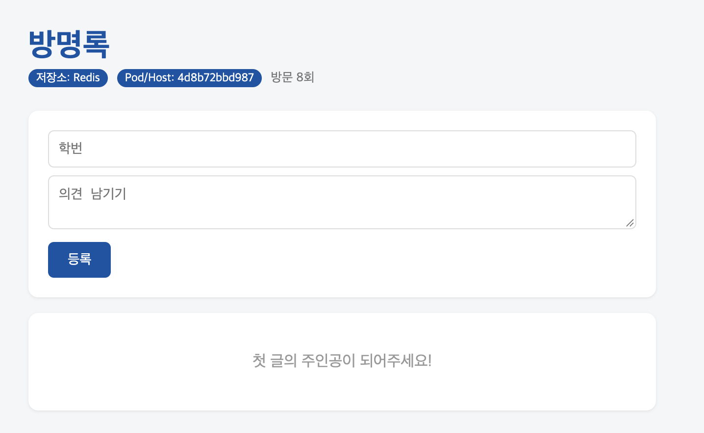
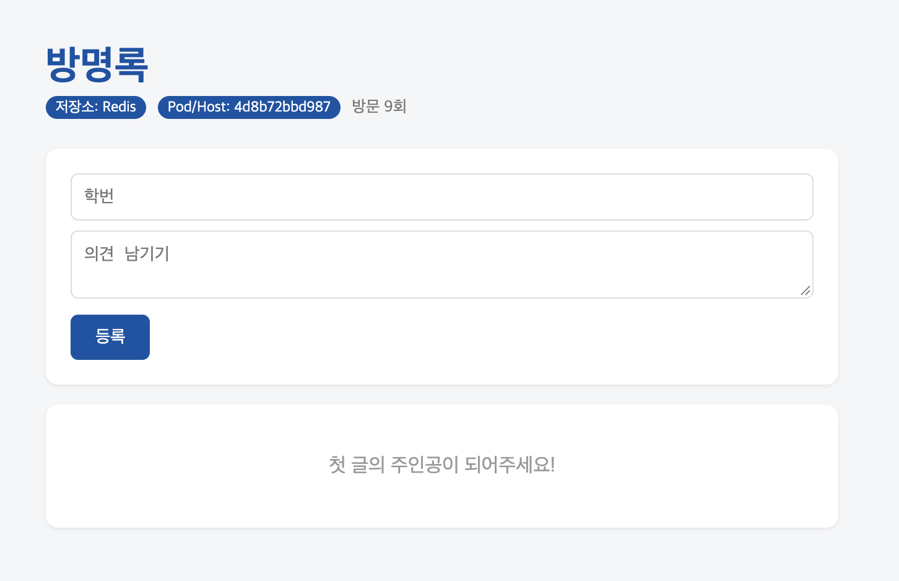

# 7주차: 도커 컴포즈

## 1. Docker Compose PS 결과 (Healthcheck 포함)
```text
NAME                IMAGE            COMMAND                  SERVICE   CREATED        STATUS                  PORTS
guestbook-nginx-1   nginx:alpine     "/docker-entrypoint.…"   nginx     7 minutes ago  Up 7 minutes            0.0.0.0:8080->80/tcp, [::]:8080->80/tcp
guestbook-redis-1   redis:7-alpine   "docker-entrypoint.s…"   redis     35 minutes ago Up 11 minutes (healthy) 6379/tcp
guestbook-web-1     guestbook-web    "python app.py"          web       7 minutes ago  Up 7 minutes (healthy)  5000/tcp
guestbook-web-2     guestbook-web    "python app.py"          web       7 minutes ago  Up 7 minutes (healthy)  5000/tcp
guestbook-web-3     guestbook-web    "python app.py"          web       7 minutes ago  Up 7 minutes (healthy)  5000/tcp
```

## 2. Scale 적용 후 웹 컨테이너 호스트명 변경 결과




## 3. `down`과 `down -v` 차이점 비교
- **`docker compose down`**: 컨테이너와 네트워크만 삭제합니다. 데이터베이스 볼륨은 유지되므로 컨테이너를 다시 띄워도 방명록 데이터가 그대로 보존됩니다.
- **`docker compose down -v`**: 컨테이너와 네트워크뿐만 아니라 **볼륨(Volume)까지 함께 삭제**합니다. 볼륨 내부에 저장되어 있던 데이터베이스(`Redis`) 데이터도 완전히 사라지므로 재시작 시 방명록 데이터가 초기화됩니다.

## 4. `.env` 파일을 Git에 올리지 않는 이유
- `.env` 파일에는 데이터베이스 패스워드나 API 키 같은 **민감한 보안 정보(Secret)**가 포함되어 있습니다.
- 이를 원격 저장소(GitHub 등)에 그대로 올릴 경우 외부에 노출되어 보안 사고로 이어질 수 있으므로, `.gitignore`에 등록하여 Git 추적 대상에서 제외해야 합니다.
