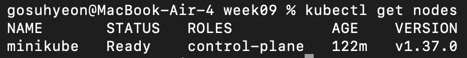
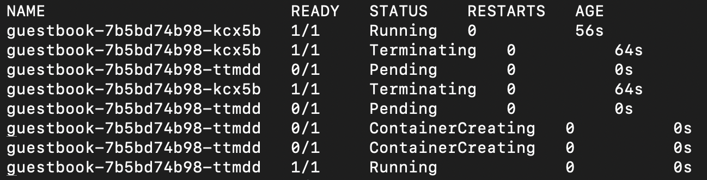
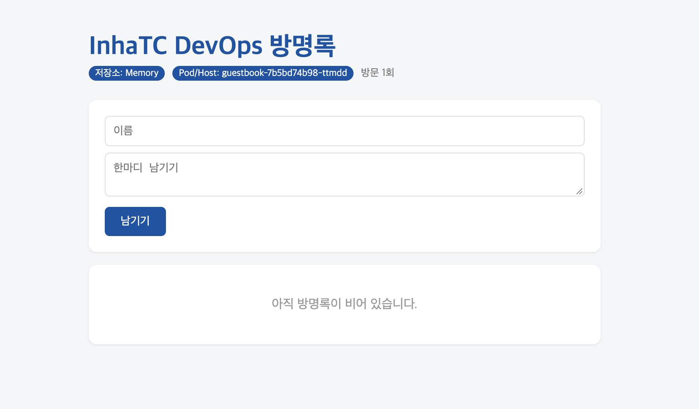

# Week 09: 쿠버네티스

## 1. kubectl get nodes 결과

## 2. 자가 치유 관찰 (Pod 재생성)
- 기존 Pod 삭제 후 쿠버네티스가 선언된 상태(replicas)를 유지하기 위해 자동으로 새 Pod를 생성한 것을 확인했습니다.

## 3. 방명록 애플리케이션 실행 화면

## 4. 선언형(Declarative)이란?
"원하는 최종 상태(Desired State)만 문서로 정의해 두면, 시스템이 지속적으로 현재 상태와 비교하며 알아서 그 상태를 유지해 주는 방식입니다. (예: 에어컨을 26도로 설정해두면 온도를 알아서 측정하며 켜고 꺼지는 것)"
