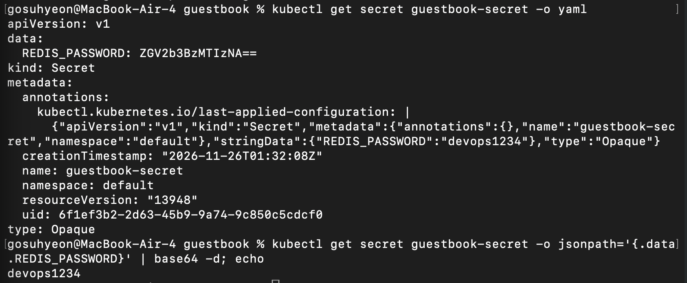
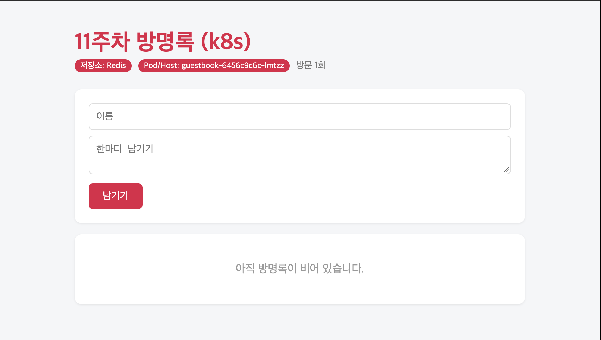
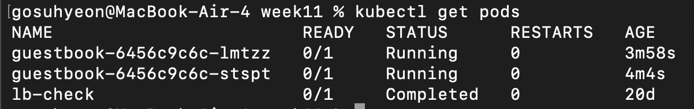
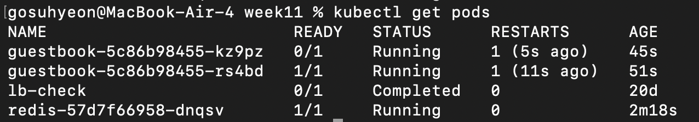

# 11주차: 쿠버네티스 설정과 상태 점검

## 1. Secret을 base64 -d로 읽은 화면 (왜 안전하지 않은지 설명하기)

### Secret이 안전하지 않은 이유
* **암호화가 아닌 인코딩:** 쿠버네티스 Secret의 `data`는 비밀번호를 열쇠로 잠그는 **암호화(Encryption)**가 아니라, 단순히 문자 표기 방식만 바꾸는 **base64 인코딩(Encoding)**입니다.
* **누구나 원본 복원 가능:** 별도의 복호화 키가 필요 없으므로, 클러스터 조회 권한이나 YAML 파일에 접근할 수 있는 사람이라면 누구나 `base64 -d` 명령어 한 줄로 실제 비밀번호를 평문으로 읽어낼 수 있습니다.
* **결론:** 화면에 바로 보이지 않을 뿐 보안상 안전하게 잠긴 상태가 아니므로, 실제 Secret 파일은 Git 저장소에 올리지 않고 접근 권한 제어(RBAC) 및 별도 저장소 암호화 설정을 함께 사용해야 합니다.

## 2. ConfigMap 변경을 통한 설정 분리 확인

## 3. Readiness / Liveness Probe 실패 실험

### 3-1. Readiness 실패 (`READY 0/1`)

### 3-2. Liveness 실패 (`RESTARTS` 증가)

## 4. 트러블슈팅 3단 루틴

1. **상태 확인 (`kubectl get pods`)**
   * 파드의 `STATUS`(Pending, CrashLoopBackOff, ImagePullBackOff 등), `READY` 비율(`0/1` 여부), `RESTARTS` 증가 여부를 가장 먼저 파악합니다.
2. **원인 이벤트 확인 (`kubectl describe pod <파드이름>`)**
   * 출력 맨 아래의 `Events` 로그를 확인하여 이미지 풀 실패, ConfigMap/Secret 이름 오타, Probe 실패 등 쿠버네티스 레벨의 원인을 찾습니다.
3. **애플리케이션 로그 확인 (`kubectl logs <파드이름>`)**
   * 파드 내부 앱이 실행되다가 죽는 경우 표준 출력 에러 로그를 확인하며, 이미 재시작된 컨테이너의 직전 에러를 볼 때는 `--previous` 옵션을 함께 사용합니다.
